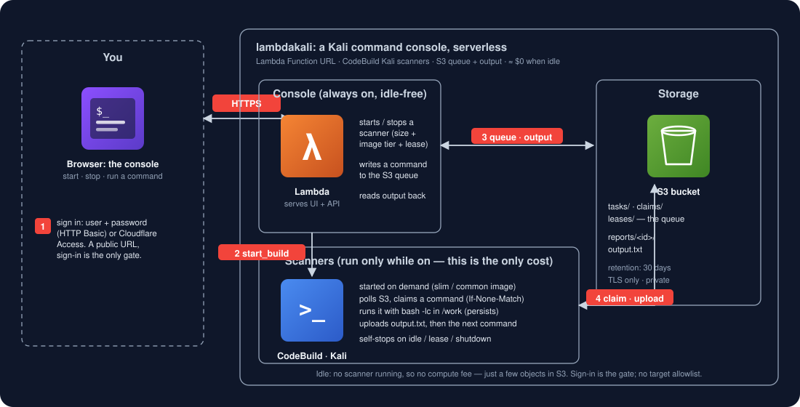

# lambdakali

**Lambda Function URL 上的 Kali 命令行控制台。扫描机是 CodeBuild 实例，像电脑一样手动开关，全部关机时 ≈ $0。**
[IdleFree](https://cloudformer.github.io/) 系列 · English: [README.md](README.md)

一台关机即 $0 的自有 Kali。开一台扫描机（选机型、镜像档位、时长），然后输入任意 shell 命令——它在下一台空闲扫描机上
运行并实时回传输出。`/work` 在扫描机存活期一直在，所以命令可以接力（`aws s3 cp …`，再 `keepass2john`，再 `john`）。
闸门是登录；没有目标允许清单（自由 shell 无法强制），所以只对你有权测试的目标运行。



| | |
|---|---|
| 网页控制台 + API | 一个 Lambda，Function URL；用密码或 Cloudflare Access 登录 |
| 扫描机 | 每台一个 CodeBuild build，新的 Kali 实例；按顺序领取队列（S3）里的命令，一次一个 |
| 镜像档位 | `slim`（常用工具，约 1 分钟启动）和 `common`（约 80% 的工具，2–3 GB）——像选机型一样在开机时选；`full` 需单独构建 |
| 一个任务 | 一条 shell 命令，在 `/work` 里用 `bash -lc` 运行 |
| 输出 | 实时显示，保存到 S3 的 `output.txt`，预签名下载链接 |
| 密钥 | SSM SecureString，在 Terraform 之外设置；以环境变量传给命令，输出里显示为 `***` |
| 权限 | 扫描机角色最小权限；要更多（如读某个 S3 路径）通过 `scanner_policy_statements` 授予 |
| 空闲费用 | 全部关机时 ≈ $0（CodeBuild 按开机的分钟计费） |

## 示例：测试 KeePass 库的主密码

用 `scanner_policy_statements` 给库路径授予 `s3:GetObject`，开一台 `common` 扫描机，运行：

```
aws s3 cp s3://my-vaults/keepass/x.kdbx .
keepass2john x.kdbx > hash
john hash
```

镜像里没有的东西按需安装——它是带 apt 和网络的 root shell：

```
apt-get update && apt-get install -y hydra && hydra -h
```

## 部署

用 Terraform module，用法、变量、镜像档位和输出见
[cloudformer/infra/aws//modules/lambdakali](https://registry.terraform.io/modules/cloudformer/infra/aws/latest/submodules/lambdakali)。
运行 Terraform 的机器上要开着 Docker：它会构建每个镜像档位（arm64）并推到 ECR（`common` 档位 2–3 GB，第一次 apply 会比较久）。

## 只运行你有权运行的目标

它会在一台带着你 AWS 角色、（登录之后）可从互联网访问的机器上运行任意命令。只在你自己的账号里、对你拥有或有书面授权测试的主机使用。保持登录开启。

## License

MIT
