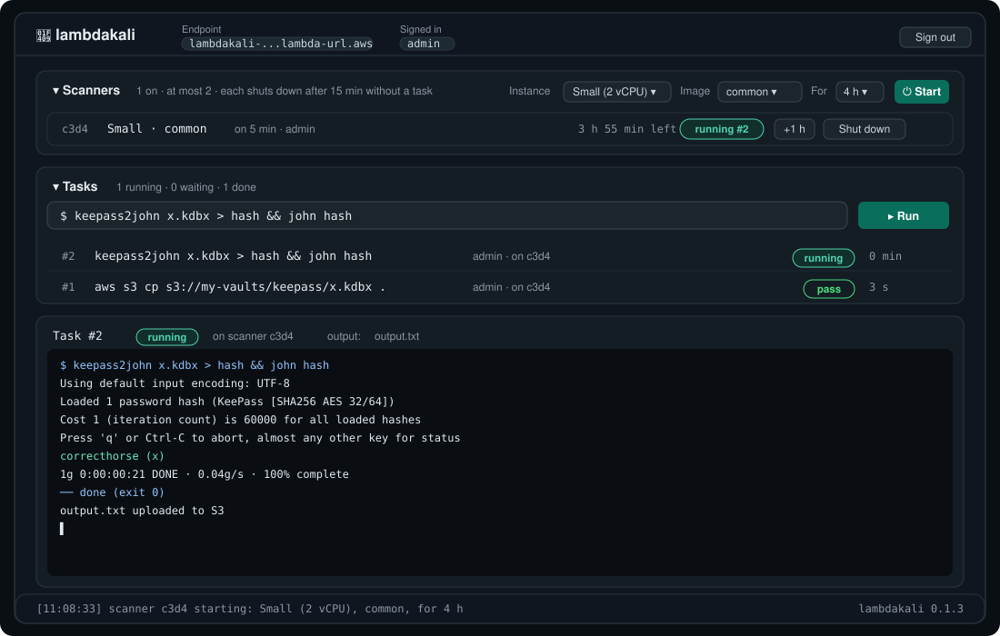
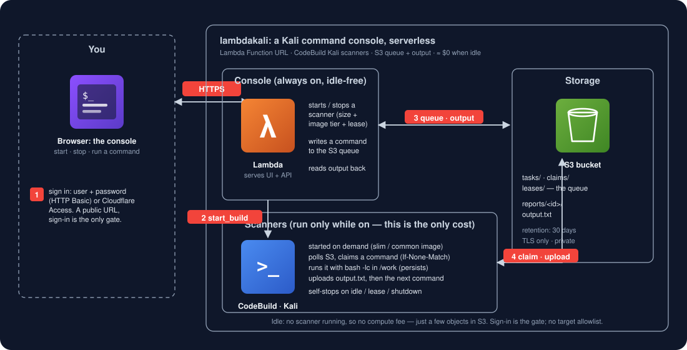

# lambdakali

**A Kali command-line console on a Lambda Function URL — scanners are CodeBuild instances you start and shut down
like machines, ≈ $0 while none is on.** Part of [IdleFree](https://cloudformer.github.io/).

This package holds the service: the Lambda (web console + API) and the scan image's build context (Kali rolling + the
tool tiers + the scanner loop). Deploy it with the Terraform module
[cloudformer/infra/aws//modules/lambdakali](https://registry.terraform.io/modules/cloudformer/infra/aws/latest/submodules/lambdakali),
which installs this package from PyPI. Project: [cloudformer/lambdakali](https://github.com/cloudformer/lambdakali).
